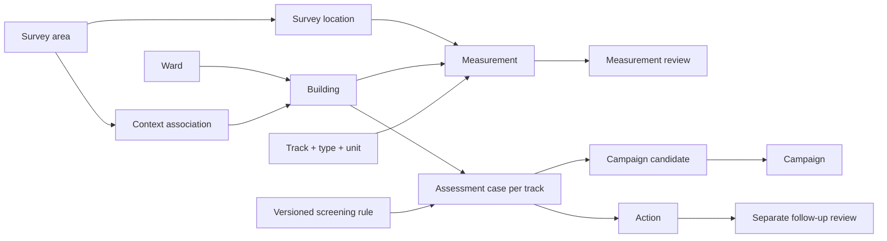

# How Nila's database fits together

A model is a Python description of a database table. A foreign key links a row
to another table; a CHECK constraint rejects an invalid combination of values.
The initial Alembic revision is a frozen schema snapshot. It does not import
the current models, so future model edits cannot silently rewrite history.

| File | Responsibility |
| --- | --- |
| `app/models/common.py` | Officers, timestamps, synthetic batches, audit records |
| `app/models/places.py` | Wards, buildings, survey areas/locations, context links |
| `app/models/evidence.py` | Measurement types/units, measurements, reviews, rule versions |
| `app/models/planning.py` | Cases, campaigns, candidates, plan snapshots, equipment, overrides/escalations |
| `app/models/workflow.py` | Guidance, actions, follow-up decisions, private request intake |
| `app/seed.py` | Atomic fictional dataset and read-only capacity summary |

## Measurement evidence is not screening priority

Each measurement references exactly one building or survey location. Its
composite foreign key references a `(track, measurement_type, unit)` catalogue
entry. The initial catalogue permits indoor radon concentration in `Bq/m3` and
regional ambient gamma dose rate in `uSv/h`. Invalid combinations fail in MySQL.
Other quantities/units must be deliberately added with documented semantics;
there is no implicit conversion or universal radiation score.

`Numeric` columns preserve decimal readings. `NULL` means unknown; a missing
value stays `NULL`. A submitted measurement requires a value, a start, an end
or duration, and an instrument; incomplete records can retain unknown fields.
Times are stored as UTC DATETIME values. If both duration and an end time are
provided, they must agree. Source, notes, review quality and synthetic status
remain explicit. Quality acceptance does not establish long-term exposure.

Each building can have one current assessment case per track. A case separately
stores priority, evidence availability, workflow status and scheduling status.
Non-unknown priority references a rule version of the same track. Demo rules
contain no scientific thresholds and are labelled unvalidated. They designate
fixture membership to demonstrate allocation; they do not derive health risk.
Future changes must create a new rule version, and plan snapshots will retain
the versions/inputs used. Policy-editing services do not exist yet.

## Survey association

`building_survey_contexts` stores a source, method and explanation for each
building/area link. Demo polygons are authored offshore in the South Pacific,
and demo containment links are labelled `synthetic_fixture`. A test checks
containment in these simple rectangular fixtures. The general GeoJSON import
and point-in-polygon algorithm comes in Phase 5.

A context link does not copy a survey reading to a building. Buildings without
coordinates have no automatic area link. The future map must label the entire
region as fictional, and real geography must never inherit this synthetic data.

## Allocation and workflow storage

The schema provides candidate membership, recorded inputs and random seeds,
selection explanations, queue categories, rule versions and audit reasons.
Unique constraints prevent duplicate cases and duplicate ranks within one plan.
A plan's arithmetic must satisfy `unmet = demand - selected` and selections
cannot exceed capacity. These tables are empty after seeding: Phase 6 implements
the actual planner and its cross-record consistency checks.

The 25/10 campaign references exactly 25 equal-priority cases with identical
waiting times and a common deadline. Each retains an officer, next action and
waiting status. Permission to wait is **unknown**, so the demo never assumes
qualified approval. The 3–5–2 weights are only an unvalidated example.
The summary reports a minimum shortfall of 15 but makes no selections and
does not create an escalation; plan generation in Phase 6 must do that.

Bookings have start/end times and indexes for interval lookup. A seeded
detector stays assigned for multiple days. Interval ordering is enforced now;
**overlap prevention and transactional equipment locking arrive in Phase 6**.
The existence of a booking table is not a claim that double-booking prevention
is implemented. Campaign staff/equipment capacity stays unknown when not set.

An action completion report is stored separately from follow-up evidence and
review decisions. The fixture includes reported-complete work whose case is
still follow-up pending. Phase 7 implements allowed transitions and ensures
cross-record workflow consistency; arbitrary direct SQL can bypass application
workflows and should remain restricted to administrators.

Audit/override rows require reasons. Audit event production for all later
workflows, immutable-version edit services and tamper-resistant logging are
not implemented in this phase. The seed itself creates an audit event.

## Demo contents and public boundary

The v1 batch has 50 buildings in five wards, 55 assessment cases (50 indoor,
five regional), 19 measurement records (15 indoor including one incomplete,
four survey observations), five due follow-ups, five action records and one
multi-day equipment booking. Ember Ward has no measurements. Two buildings
have unknown coordinates. Every domain fixture row has synthetic provenance.

Three disabled fictional officers allow assignment examples. Their password
hashes are generated from random secrets that are not retained. No shared demo
password or usable login is created by seeding. The separate Phase 4
`create-officer` command creates actual operator accounts with hashed passwords.
Officer sessions store only token hashes, expirations and revocations. The
login-throttle table persists counters across web-process restarts. Buildings
have a version counter to detect stale edits; migration 0002 preserves existing
rows while initializing this counter.

The public-request table is private intake storage. Public aggregation and
abuse-protected forms arrive in Phase 8. Current foundation routes expose no
building rows, officer notes or password hashes. Public interfaces must use
curated aggregates rather than generic model serialization.
